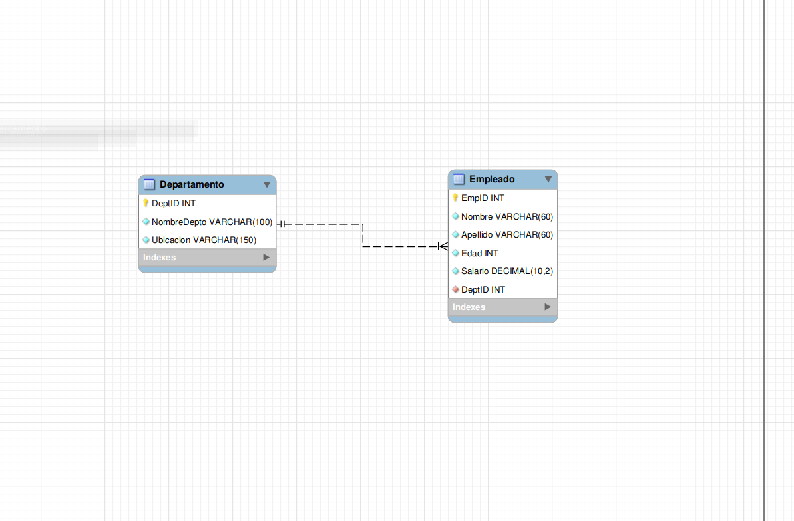

# Entrega de Base de Datos Relacional - MySQL 8.0

Este repositorio contiene el diseño, modelado e implementación del esquema de base de datos relacional `empresa_db`, desarrollado en **MySQL Workbench 8.0** para la gestión de departamentos y empleados de una organización.

---

## 📁 Estructura y Archivos Entregables

El proyecto se compone de los siguientes archivos en la raíz del repositorio:

1. **`diagrama.mwb`**: Archivo fuente del modelo relacional editable creado con **MySQL Workbench 8.0**, incluyendo entidades, relaciones, llaves primarias, llaves foráneas y tipos de datos.
2. **`diagrama.png`**: Representación gráfica exportada del diagrama físico/relacional del esquema.
3. **`script_ddl.sql`**: Script en lenguaje de definición de datos (**SQL-DDL**) compatible con **MySQL 8.0** (motor `InnoDB`, codificación `utf8mb4`), que implementa la creación de la base de datos `empresa_db` y las tablas `Departamento` y `Empleado` respetando la integridad referencial.

---

## 📊 Diagrama Relacional

A continuación se presenta el diagrama del esquema entidad-relación implementado:

---

## 🛠️ Especificaciones del Esquema

### 1. Tabla `Departamento` (Entidad Independiente)
* **`DeptID`**: `INT NOT NULL AUTO_INCREMENT` (Llave primaria).
* **`NombreDepto`**: `VARCHAR(100) NOT NULL` (Nombre del departamento).
* **`Ubicacion`**: `VARCHAR(150) NOT NULL` (Ubicación física del departamento).

### 2. Tabla `Empleado` (Entidad Dependiente)
* **`EmpID`**: `INT NOT NULL AUTO_INCREMENT` (Llave primaria).
* **`Nombre`**: `VARCHAR(60) NOT NULL` (Nombre del empleado).
* **`Apellido`**: `VARCHAR(60) NOT NULL` (Apellido del empleado).
* **`Edad`**: `INT NOT NULL` (Edad del empleado).
* **`Salario`**: `DECIMAL(10,2) NOT NULL` (Remuneración salarial).
* **`DeptID`**: `INT NOT NULL` (Llave foránea hacia `Departamento.DeptID`).

### 3. Relación e Integridad Referencial
* **Relación:** 1 a N (`Departamento` 1 : N `Empleado`).
* **Restricción de clave foránea:** `fk_empleado_departamento`
  * `ON UPDATE CASCADE`: Las actualizaciones en `DeptID` se propagan automáticamente.
  * `ON DELETE RESTRICT`: Evita la eliminación de un departamento si tiene empleados asociados.
* **Motor de almacenamiento:** `InnoDB`.
